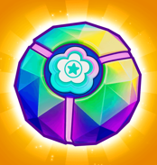

  

<h1 align="center">Evomon</h1>

<b>Macro app de escritorio para Roblox</b> <i>by CEBOLLIN</i>

---

## ⬇ Descargar

  

> Descarga el ZIP, extráelo y abre `Evomon.exe`. No necesitas instalar nada.

---

## ¿Qué es?

Es un juego de rol y aventura de mundo abierto inspirado en la captura de criaturas.

## Funciones

- ⏺ Grabar secuencia de acciones
- ▶ Reproducir en bucle automático
- ⏱ Timer de respawn configurable
- 💾 Múltiples perfiles por monstruo
- ⌨ Teclas de acceso rápido (F6 / F7 / F8 / F9)
- 🔄 Carga el último perfil usado al abrir

## Requisitos

- Windows 10 / 11
- No requiere instalación

---

Hecho con Python • by CEBOLLIN

